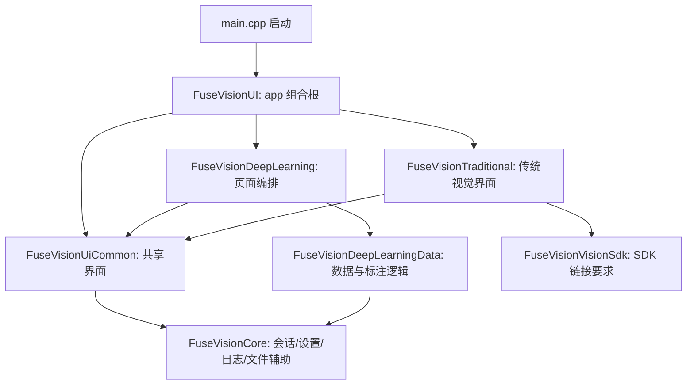

# FuseVision 架构与模块边界

当前源码核对：2026-11-17。以目录、CMake 链接目标和回归为证，历史分析保留在验证记录。

## 1. 架构风格

Qt Widgets 本地桌面应用。应用组合根创建业务页面；共享核心服务、共享 UI、深度学习数据和业务 UI 分目标编译。保留既有单例和信号槽，不引入插件容器、远程服务或新执行引擎。未登录可浏览全部页面，单账户登录后统一可写。

## 2. 依赖关系

箭头表示使用方向。Core 链接 Qt Core/Sql，Data 使用 Qt Core/Gui（QImage、QUndoStack），两者不依赖 Qt Widgets。UiCommon 才引入主题、弹窗与通用控件。UI 主窗口公共头只前向声明业务页面；具体类型在组合根实现中引入。深度学习和传统视觉互不引用，SDK 头文件和链接要求只进入传统视觉目标。

## 3. 目录与职责

| 目录 / 目标 | 职责与边界 |
|---|---|
| src/core / FuseVisionCore | 账户、会话、设置、日志、原子单文件与可恢复移动；不包含业务页面或弹窗 |
| src/ui / FuseVisionUiCommon | ThemeManager、LogMonitor、LoadingOverlay、PermissionGuard、WriteAccess；仅 GUI 线程使用 |
| src/deeplearning/domain | AnnotationShape、DatasetTypes、ProjectTypes、ModelTypes 值对象；不包含 Widget 或存储类 |
| src/deeplearning/model、render | 权威编辑状态、事务、撤销、保存基线与图像渲染；不包含界面头文件 |
| src/deeplearning/storage | StorageContract统一原生配置版本/字段与路径；ProjectConfig、ModelConfig、AnnotationStore、DatasetFileService、兼容AnnotationIO |
| src/deeplearning/tools | 图像坐标工具；借用 Context 中的模型和渲染器，不持有页面 |
| src/deeplearning/widgets | 对话框、卡片、图库、画布和页面协调；授权、未保存决策与结果反馈 |
| 原生标注边界 | widgets 处理视图/快捷键，tools 处理几何输入，model 持有权威状态；LabelMe 运行适配已退役 |
| src/traditional / FuseVisionTraditional | 现有传统视觉布局与占位工具栏；未实现算法执行、采集或标定引擎 |
| src/app / FuseVisionUI | 主窗口、登录、账户设置和系统设置；业务页面为私有链接依赖 |

## 4. 核心调用关系

项目/模型配置读取 → 页面激活上下文 → 数据集图像打开 → AnnotationModel 载入基线 → 工具事务修改 → AnnotationStore 保存成功 → markClean/统计刷新 → 返回图库 → 重开 → DatasetFileService 暂存导出。形状值对象独立于撤销模型，文件服务不再包含 DatasetManagement.h，AnnotationModel 不再反向包含 AnnotationManagement.h。

AccessControl 只判断会话；WriteAccess 在 GUI 线程记录拒绝并弹窗。所有已实现写处理器继续检查返回值，按钮 enabled 不构成授权。Data 服务不读取登录态，成对导入/导出等由调用方提供 Allowed 回调，在写检查点复核。

AnnotationStore用QSaveFile提交单文件，失败保留已有目标与编辑状态；DatasetFileService处理配对备份/回滚和空目标暂存导出。RecoveryStore提供同卷可恢复移动，目录策略由业务调用方决定。StorageContract由数据层与数据集/模型页面共同消费，统一项目、模型、数据集原生配置的类型/版本/字段检查；GTest只链接测试目标，不进入应用依赖。新模型目录与迁移兼容规则见[数据契约](../logic/DATA-CONTRACTS.md)。标注类别编号保持不变。

分类模式由DatasetManagement按固定目录构建样本与只读预览，DatasetFileService负责解码导入及保留划分的暂存导出；StorageContract统一原生1.0格式、必填字段及模式守卫，新模型立即生成数据集配置；旧掩码回退拒绝。数据库目录解析和一致副本迁移留在DatabaseManager，默认启动消费SettingsManager目录并记录最近活动文件；错误由main显示，不将弹窗引入Core。依赖边界和目标链接保持不变。

## 5. 约束、文档与剩余耦合

cmake/ModuleBoundaries.cmake 在配置阶段拒绝核心/数据向 UI 及业务模块反向链接。tests/check_module_boundaries.py 检查源码 include 白名单。独立 FuseVisionDataTests 只用 QCoreApplication，编译时拒绝 QT_WIDGETS_LIB，并验证配置、标注 round trip、失败保持和图像配对导出。

Doxygen 入口为 docs/Doxyfile，按上述职责生成模块/类/文件索引；关键接口注释包含线程、所有权、类别编号和失败语义。生成 HTML/XML 位于 out/docs/doxygen，不提交生成物。EXTRACT_ALL 使历史声明可浏览，不代表每个历史成员均完成注释。格式配置见 .editorconfig、.clang-format；Doxygen 不替代 C++ 编译和业务测试。

DatasetManagement 仍承担 COCO 编排、统计和表单；DeepLearningWidget 只协调内部页面和上下文；外部进程及 Windows 嵌入代码已删除。此次先建立可验证边界，没有同时重写它们。文件配对与 QSettings 不承诺断电事务。相机、可见 Windows 交互、Debug 和真实负载性能未因此获得验证。

## 6. 代码证据

[src/CMakeLists.txt](../../src/CMakeLists.txt)、[深度学习目标](../../src/deeplearning/CMakeLists.txt)、[链接边界](../../cmake/ModuleBoundaries.cmake)、[文件服务](../../src/deeplearning/storage/DatasetFileService.h)、[数据回归](../../tests/data_contract_regression.cpp)、[验证记录](../logic/VALIDATION.md)。
