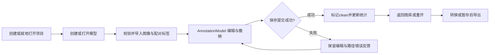

# 核心工作流（2026-11-17 更新）

当前代码与自动回归以 [VALIDATION.md](VALIDATION.md) 为准。2026-11-14 的截图和 runtime-ui.json 保留为缺陷复现历史；它们不表示本轮修复后的状态。

本次修复（2026-11-17）：ISS-011～014已修复，Release CTest 6/6通过，见[新证据](VALIDATION.md#2026-11-17-四项问题修复)。下图描述代表性流程，不表示全部输入均已验收。

2026-11-17模块整理不改变下述交互：领域数据、编辑模型、存储、渲染与工具在`src/deeplearning`的独立目录，界面在widgets。通用会话/授权在core，拒绝弹窗在ui，组合根在app；传统视觉独立。调用与依赖见[架构](../codebase/ARCHITECTURE.md)，本轮核心链回归已复跑。

## 单账户与只读模式

启动不再强制登录。未登录可访问四个一级页面、全部深度学习标签页，并就地打开项目/模型、查看图库和标注；不修改标签、项目/模型配置、类别或设置。创建、导入、删除、标注编辑、保存、转换、导出和修改设置统一要求已登录，按钮与处理器同时控制。只读不等于禁止浏览，传统工具分类也可展开查看。

左下角“登录，解除只读”打开固定账户密码框；密码错误/取消保持只读。登录后统一解锁所有已实现的写操作，不使用角色或模块权限矩阵。再次点击为退出登录：先以仍可保存的登录态处理未保存内容，保存失败/取消阻止退出，成功或放弃后恢复只读并保留当前页面与已打开上下文。

账户设置页只保留状态和修改密码（当前密码、新密码至少6位、确认密码）。不再添加/删除账户或编辑权限；不自动填入/记住解锁密码。历史账户与权限表保留但不提供多账户登录。新库唯一账户是superadmin，默认密码admin123；已有库优先沿用superadmin及其原密码，否则沿用角色值最高、ID最早的已有账户。role仅用于无superadmin时选择历史兼容账户，不再决定权限。

## 项目与模型

用户决定采用新数据标准；原生项目/模型/数据集必须带类型与1.0版本和必填字段，无标记旧文件、旧布局和未知格式拒绝读取/覆盖，不自动升级。项目内相对引用可随目录移动；只读打开不改文件。新模型立即生成完整数据集配置。新标注模型创建实际使用的平铺images/labels，分类仍为六目录；工作索引与YOLO导出分区分开，详见[文件契约](DATA-CONTRACTS.md)。数据集配置失败保留磁盘文件，修正后可重试；已成功提交的标签不会因派生统计失败被撤销。

新项目成功创建后刷新卡片，仍需正式打开。单击卡片只预览；当前工作项目和模型以正式打开状态为准。打开项目文件时在原目录读取，不再自动迁移、复制或静默采用默认目录中的同名项目；已移动项目的根目录取所选 project.fvproj 所在目录，合规的相对模型路径在内存中解析为绝对路径，旧绝对根引用拒绝。

新模型名称和类型通过校验后创建配置及目录，中文描述写入 .fvdl。路径由项目派生且只读。创建成功只发送一次 currentModelChanged 和 modelCreated；取消不发送成功通知。模型单击预览、双击激活；数据集只订阅当前模型变更。外部模型复制到新目录并登记，拒绝同名目录/条目，复制或注册失败不切换当前对象。

删除以明确选中卡片为目标，确认显示名称、目录及配置文件。当前对象删除先处理未保存内容；非当前对象删除保留活动上下文。文件通过同卷移动保留在 .fusevision-trash，模型项目登记失败尝试回滚。样本删除同步移动精确配对标签，restore.json 记录原路径。没有自动清空恢复目录的规则。

## 导入与类别

图像和同基名标签组成一组。重名可以成对覆盖、整体跳过或取消；同基名多图、多格式歧义、损坏图像、掩码尺寸错误与非法JSON均报告路径。已有其他格式标签时拒绝新增会被旧格式遮蔽的标签。覆盖先暂存和备份，单组失败回滚；批量报告成功、跳过、失败与重试源。批量并非一次跨文件系统的事务，已完成组可保留。

普通JSON与PNG先复用重开读取器进行语义校验，再进入暂存/备份/提交；非法bbox、类别或不支持形状失败时保留旧配对。分类模式按train/val/test下OK/NG读取和导入，图库统计使用目录类别，双击只读预览，导出保留划分与类别。分类模式不进入区域标注；配置模式与模型布局不匹配时拒绝加载/保存。

聚合COCO先校验全部图像、引用和路径；按类别名称把外部编号映射到现有槽位或末尾新增，保留空标注。限制压缩RLE等不支持数据时明确拒绝。普通导入仍只收集 images/ 与 labels/ 直属文件；分区文件转换可按原有路径处理，但本轮没有开发数据划分。

有持久化标注（递归png/json/txt/xml）或未保存编辑时，禁止删除和重排类别。重命名保持编号，新增只追加；本轮不迁移或批量重编码已有标签。

## Qt原生连续标注、保存与离开

Qt Widgets工作区内完成六工具编辑。矩形支持拖放及既有两次点击，Enter支持反向完成；多边形保留已放置边链。选择按模型命中，列表UUID对应并保持选择，每次拖动一个撤销，Esc/失焦恢复未提交拖动或笔画。控制点按屏幕尺寸显示，画笔光标显示笔径。

旋转框平移和粘贴同时偏移bbox与显式中心，隐式中心保持空哨兵；撤销/重做与保存重开均保持中心。已有回归验证90°角点位移，旋转角度拖动仍未实现。

滚轮围绕鼠标缩放，中键/空格左拖平移；同模型切图默认保持视野，可关闭。Ctrl+0适应、Ctrl+1原始大小；亮度/对比度不重置视野。H仅切换叠加层显示。Ctrl+Enter或“保存并下一张”在保存成功后前进；失败或未完成绘制留在当前图，末图保存后停留。快捷键在类别/形状列表焦点下也生效。LabelMe进程与嵌入入口已退役。

AnnotationModel 持有唯一形状列表、保存基线及撤销栈。工具、画布、列表、删除、隐藏、复制、保存读取同一集合。加载清空撤销历史并置clean；undo回到保存基线也为clean。

多边形按点击/Enter/双击闭合。画笔支持单击与连续笔画，橡皮只擦除画笔/填充掩码；填充针对相近颜色的未标注连通区域。Esc取消当前绘制或选择拖动，不提交预览。

AnnotationStore 校验图形、类别和掩码尺寸，检查目录创建、编码、打开、写入、提交结果，用 QSaveFile 替换单个标签文件。失败保留编辑、dirty和旧文件，反馈路径及原因；只有标签提交成功才通知数据集。派生统计保存失败单独告知，标签保留并可重开重建。

切图、返回图库、切页、切换项目/模型、退出登录和关闭窗口复用保存/放弃/取消。保存失败阻止离开；放弃重新读入已保存内容；取消保持当前上下文。提示期间暂停自动保存，避免决策时数据变化。30秒自动保存仍只在绘制完成且有写权限时执行。

导航入口按值保存目标模型与路径，再刷新样本及处理保存决策；销毁标注页前停止自动保存、断开模型/撤销栈到页面信号并取消未提交工具，避免过期路径引用或已销毁按钮回调。Debug崩溃及修复证据见[ISS-016](../refactor/ISSUES.md#iss-016)。

## 转换与导出

转换使用同一读取器及YOLO编码器，保留源标签，不再使用猜测的640尺寸；缺配对、非法类别或坐标反馈完整路径。覆盖不同的txt前需确认，相同内容跳过。

导出有选中时仅导出选中样本，否则全部。目标要求空目录，整批在同级暂存目录生成，成功后改名提交；错误或权限变化不提交半成品。COCO包含配对图像、一致的类别编号、旋转后顶点以及非压缩RLE；YOLO按当前task映射编码并提示轮廓、孔洞或旋转信息损失。未标注图像可能被目标格式表现为空目标，报告中明确提示。原生PNG导出保留文件字节。

## 数据库重启与恢复

保存目录仅更改下次启动配置。启动优先使用目标已存在的库；空目标从最近活动库建立一致副本，包含已提交WAL页且保留原库，密码不重置。记录的来源缺失、目标不可写或迁移失败会阻止启动并显示原因；修复路径/来源后重试。独立进程已验证配置读取、迁移、再次迁移及密码保持。

## 验收边界

合成样本的工具→保存→重开→转换/导出业务回归通过，失败恢复和权限拒绝有实际处理器测试。完整可见Windows桌面流程、所有原生文件对话框及相机未实测，不能据offscreen通过宣布全产品验收完成。异常分类采用明确OK/NG模式并拒绝旧掩码配置回退，未来模式选择界面与矩形任务命名仍待产品决策；训练、预测、模型导出等占位功能没有扩展。
