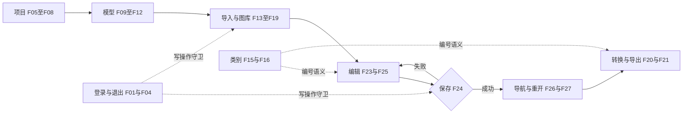

# 功能关系与失败传播

最近核对：2026-11-17；范围：当前功能关联及Release回归复跑，另以诊断探针核对高风险边界。执行证据见[当前核对](VALIDATION.md#2026-11-17-当前功能核对)。

[功能清单](FEATURES.md) · [状态迁移](STATE-MACHINES.md) · [测试追踪](TEST-TRACEABILITY.md)

| 关系ID | 功能关系 | 依赖/共享数据 | 失败传播与不变量 | 对应追踪 |
|---|---|---|---|---|
| REL-001 | F07项目激活→F11模型→F17图库 | 正式打开的项目/模型上下文；卡片预览另存 | 取消切换或保存失败保留当前上下文；删除非当前对象不清当前对象 | TC-001、TC-005 |
| REL-002 | F13/F14导入→F17浏览→F23编辑 | 图片与同基名标签精确配对 | 单组暂存提交失败恢复旧配对；批量已成功组可保留，不宣称整批事务 | TC-006 |
| REL-003 | F23/F25编辑→F24保存→F26/F27导航重开 | AnnotationModel、AnnotationStore、保存基线 | 仅提交成功清dirty；失败保留编辑、旧文件和当前图片 | TC-002、TC-003 |
| REL-004 | F15/F16类别→F23标注→F20/F21转换导出 | 稳定类别槽位；内存0起、文件编码按契约 | 已有标签或未保存内容时拒绝删除/重排；格式编号与几何不得猜测 | TC-007、TC-008 |
| REL-005 | F01登录/F04退出→所有写操作 | SessionManager登录态、界面与处理器守卫 | 访客可读但写入拒绝；退出前处理未保存内容，失败/取消不退出 | TC-004 |
| REL-006 | F24成功保存→F19统计→F17展示 | 已提交标签中的可见形状 | 统计是派生数据，失败单独反馈；不能把标签提交失败显示为已保存 | TC-002、TC-009 |
| REL-007 | F36设置→后续打开项目与日志 | 活动目录、下次启动配置、Logger | 默认根修改不静默迁移工程；日志即时，其他根按生效契约 | TC-010 |

以上关系覆盖当前高风险链路，并非全部可能组合。占位的数据检查、划分、训练、预测及模型导出不列为已接通下游。

本轮补齐并验证：REL-002普通JSON覆盖前语义校验及classification目录→图库→分类导出；REL-003旋转框移动/复制中心同步；REL-007保存数据库目录→独立进程打开与保留账户迁移。TC-013～016均通过；分类双击走只读预览，区域mask编辑用于符合annotation新标准的标注模型，异常分类拒绝旧mask回退。原生文件选择器与可见桌面仍未人工验收。

## 导图主流程关联

此表是总览XMind关联线的维护源；分组和截图布局另由配置管理。节点沿用功能编号，条件写在线标题中，生成器不内置业务跳转。

| 起点 | 终点 | 关联线文字 |
|---|---|---|
| F07 | F11 | 项目→模型 |
| F11 | F13 | 模型→导入 |
| F13 | F17 | 导入→图库 |
| F17 | F23 | 打开标注 |
| F23 | F24 | 编辑→保存 |
| F24 | F26 | 保存成功后导航 |
| F24 | F23 | 保存失败保留编辑 |
| F26 | F21 | 重开与导出 |
| F01 | F24 | 写入需登录 |

完整功能回归补充：REL-003的导航目的值在刷新列表前复制，避免保存/重开链路访问失效样本；页面销毁前停自动保存并断开撤销栈回调（ISS-016）。REL-004补验无标签重排失败恢复与成功重试，REL-007补验主题隔离持久化和日志显示（TC-019）。当前执行映射及交付编解码TC-020见[追踪门禁](TEST-TRACEABILITY.md#执行门禁映射)。关系和业务状态含义保持；原生Windows三组自动事件通过仍不外推到人工/硬件验收。
