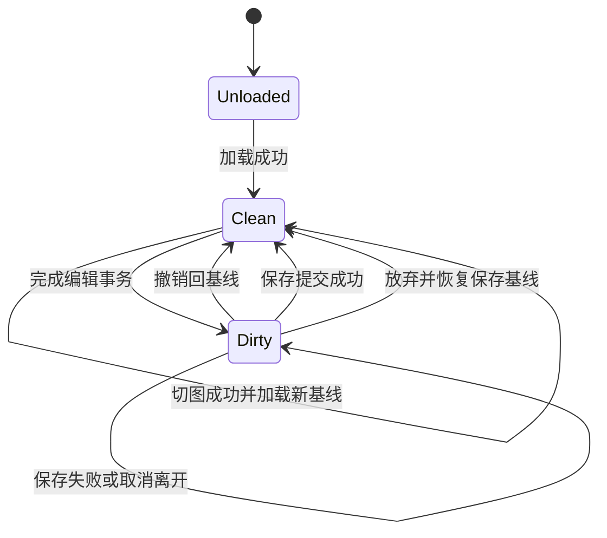
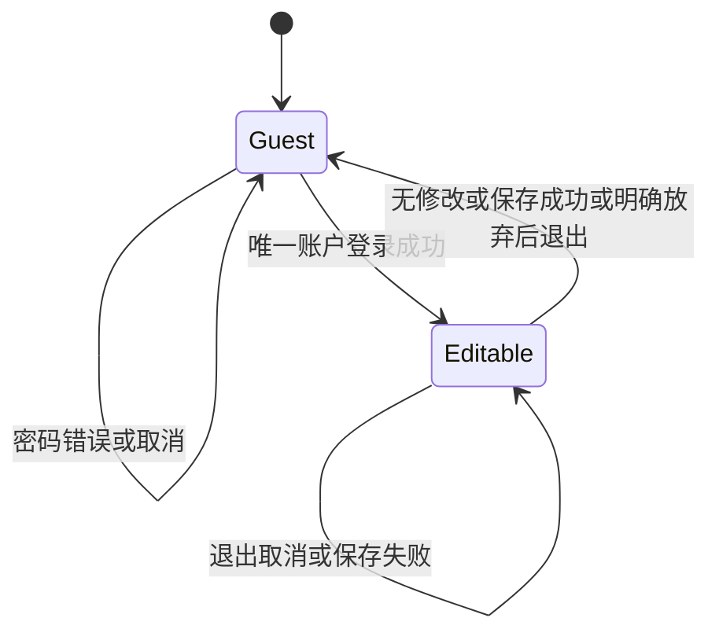

# 核心状态与迁移表

最近核对：2026-11-17；范围：当前核心流程、保存与会话处理的静态建模。本次补齐分类只读预览与数据库重启迁移，Release CTest 6/6通过，范围见VALIDATION。
这里的状态名用于解释业务，不代表源码中新增了同名枚举。

[主流程](CORE-FLOW.md) · [功能关系](FEATURE-RELATIONS.md) · [测试追踪](TEST-TRACEABILITY.md)

## 标注与离开

绘制预览与已提交编辑分开：预览未完成时不应假装已经持久化；Esc/失焦按工具契约恢复未提交预览。保存过程是事件及结果，避免误称程序已有独立“保存中/保存失败”持久状态。

## 会话与写权限

访客与登录态均可浏览页面；是否有当前图片/模型、是否正在绘制等条件还会限制具体操作，不把“登录”当作所有按钮必然可用的充分条件。

| 迁移ID | 当前状态与事件 | 条件/动作 | 结果与禁止行为 | 追踪 |
|---|---|---|---|---|
| ST-ANN-001 | 无图片→打开图片 | 标签可读取；模型重置保存基线 | clean；加载本身不产生用户编辑dirty | TC-002 |
| ST-ANN-002 | clean→工具编辑完成 | 已登录，工具事务有效 | dirty，列表与画布读同一模型 | TC-002、TC-003 |
| ST-ANN-003 | dirty→保存成功 | 单标签文件成功提交 | clean；重开几何/类别/身份保持 | TC-002、TC-008 |
| ST-ANN-004 | dirty→保存失败 | 目标目录等写入条件不满足 | dirty与旧文件保留；不离开、不报告保存成功 | TC-003 |
| ST-ANN-005 | dirty→离开取消/放弃 | 统一未保存决策 | 取消保留；放弃恢复原基线；不隐式提交 | TC-003 |
| ST-AUTH-001 | 访客→登录 | 唯一账户认证成功 | 可执行有上下文的写操作；错误/取消保持访客 | TC-004 |
| ST-AUTH-002 | 登录→退出 | 先处理未保存内容 | 取消/保存失败保持会话；成功退出恢复只读且保持浏览上下文 | TC-004 |
| ST-CTX-001 | A活动/B预览→删除B | 明确选中目标与确认 | A保持活动；失败/取消不清A；当前对象删除才清下游 | TC-005 |
| ST-IO-001 | 导入/导出暂存→提交 | 配对、语义、权限、目标检查通过 | 成功后展示结果；失败恢复或清理暂存，不覆盖无关数据 | TC-006、TC-008、TC-013 |
| ST-CLS-001 | 分类目录→样本与预览 | 完整1.0配置、classification模式与模型布局一致，固定划分和OK/NG目录 | 计目录类别；双击只读预览，不进入区域标注 | TC-016 |
| ST-DB-001 | 保存数据库目录→重启 | 已有目标复用；空目标从最近活动库建立一致副本 | 来源保留且密码保持；记忆来源缺失/迁移失败则停止，不回落默认凭据 | TC-015 |

这些是关键迁移与不变量，不是全状态覆盖证明。实际合法/非法分支的执行情况以对应测试及证据为准。

2026-11-17完整回归补验：ST-ANN-004/005在Debug与Release复跑，修复导航刷新后目标引用失效；销毁页时停止自动保存并断开模型/撤销栈信号，避免已销毁控件回调。未改变保存、放弃、取消的业务状态规则。结果见[完整回归](VALIDATION.md#2026-11-17-完整功能关系回归与cicd)，人工桌面与硬件状态仍未验收。
