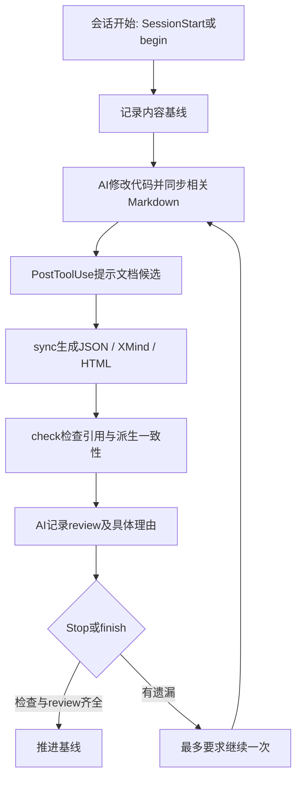

# 文档维护与自更新

最近核对：2026-11-17；范围：当前工具命令、Hooks协议与项目内生成链。具体本轮执行结果见[迁移验收](MIGRATION.md)。

[文档中心](../README.md) · [规范](STANDARD.md) · [自动目录](CATALOG.md)

本机技能、插件下载状态、项目级Qt文档MCP及使用提示词见[AI工具与技能](AI-TOOLS.md)。它们辅助分析和验证；文档自更新仍使用下述项目内流程。

## 工作方式



这是“AI维护语义＋脚本生成/检查”的自更新：工具不从任意代码变更猜测新业务，不编造截图、测试结果或产品决策。无影响也可以明确记录；环境阻塞使用deferred并在交付说明。

## 首次安装与手动生成

在项目根目录的PowerShell运行：

```powershell
./scripts/docs/setup.ps1
python -X utf8 scripts/docs/docflow.py sync --html
python -X utf8 scripts/docs/docflow.py check --diagrams
python -X utf8 scripts/docs/docflow.py serve
```

依赖锁定在scripts/docs/package-lock.json及requirements.txt，安装到out/docs-tools，不修改全局Python/Node环境；首次安装需要网络。默认Python从PATH查找，setup支持-PythonPath；钩子可通过本机会话环境变量FUSEVISION_DOCS_PYTHON指定解释器。

serve仅监听127.0.0.1，默认8765端口；用终端打印的地址阅读，Ctrl+C停止。全部文档、搜索、图片和Mermaid模块均由本地提供；双击HTML可以阅读正文，但浏览器可能阻止file协议的模块加载，完整图表请用serve。历史外部链接/徽章不作为本地阅读的依赖。

业务HTML为out/docs/site/index.html；API文档仍用[启动指南](../GETTING-STARTED.md#api文档与代码规范)中的Doxygen入口。两个生成器用途不同。

## 会话命令与降级方式

Hooks可用时自动建立基线、提醒并收尾。未启用Hooks或其他AI客户端时，在修改前手动begin；后续命令使用同一个会话ID，例如：

```powershell
python -X utf8 scripts/docs/docflow.py begin --session my-task
# 修改代码，并按实际影响更新相应MD
python -X utf8 scripts/docs/docflow.py status --session my-task
python -X utf8 scripts/docs/docflow.py sync --html
python -X utf8 scripts/docs/docflow.py check --diagrams
python -X utf8 scripts/docs/docflow.py review --session my-task --decision updated --reason "已同步保存失败和重试流程，并核对关联用例" --docs docs/logic/CORE-FLOW.md docs/logic/TEST-TRACEABILITY.md
python -X utf8 scripts/docs/docflow.py finish --session my-task
```

只改注释等不影响说明时，用review --decision no-impact --reason说明具体原因；尚未完成时用deferred，不得将其说成已同步。review是AI/开发者的核对记录，不是机器语义证明；一旦再改源文件必须重新review。

会话状态位于out/docs/sessions下，以会话ID摘要隔离。保留resume/compact中的未完成改动，不把会话前已有脏文件算成新改动；不会为每次读文件产生重复提醒。缺少基线时明确报告，事后begin不能证明第一次改动归属。生成过程共用out/docs/generation.lock，多个会话收尾会依次生成。若程序意外终止留下lock目录，先确认没有维护进程再删除对应锁，不自动清理未知锁。

## Codex项目级Hooks

配置位于仓库.codex/hooks.json和.codex/config.toml，仅本项目生效，不改用户全局配置。SessionStart匹配startup/resume/clear/compact/fork，PostToolUse按实际内容变化提示，Stop生成和检查并要求核对记录。脚本校验实际Git根，外部或嵌套其他仓库不执行FuseVision维护。

Windows通过scripts/docs/hook.ps1适配UTF-8和Python路径，命令从Git根解析，支持从项目子目录启动。Stop不尝试撤销已发生的编辑；最多续跑一次，持续失败会留下last-stop.json并要求最终交付明确未完成。

**启用需要客户端信任：**在Codex CLI运行`/hooks`，审查并信任本项目的三个事件；配置变更后按客户端提示重新审查，再开新会话验证。不要修改信任数据库或使用绕过信任的参数。当前会话在配置创建前已开始，不等于已经实际触发这些钩子。若桌面客户端没有相同的审核入口，使用支持的CLI审查并验证，期间按手动流程执行。

协议依据：OpenAI Codex官方Hooks文档（developers.openai.com/codex/hooks，核对日期2026-11-17）。当前本地协议测试与真实客户端已信任执行是不同验收项。

## 自动检查的范围

check核对本地MD链接/标题锚点、代码行号范围及当前功能/问题的符号与引用行是否一致、必填字段/编号、生成镜像一致性、输入/输出摘要、导图节点/关系/嵌图及123份迁移前原始资料摘要。check --diagrams另用锁定Mermaid解析当前图语法。它不修改旧报告，也不声称理解全部代码语义。

sync只生成features.json、issues.json、导图JSON/.xmind、CATALOG.md和generated-manifest.json；--html另生成out下阅读文件。历史字段从已保护的归档读取，当前业务事实及主流程关联线从MD读取。归档数据有改动时先check，不能用修改归档来“更新”旧事实。HTML会检测正文、代码预览、下载和已生成文件摘要，源变化或产物缺失时重建；原样再生成不刷新文件。

独立CI在.github/workflows/docs.yml中对push、pull_request或手动触发执行工具测试、只读检查、Mermaid校验与HTML生成，并上传阅读产物；不会在CI中自动改写/提交MD。远端运行前不宣称CI已通过。
